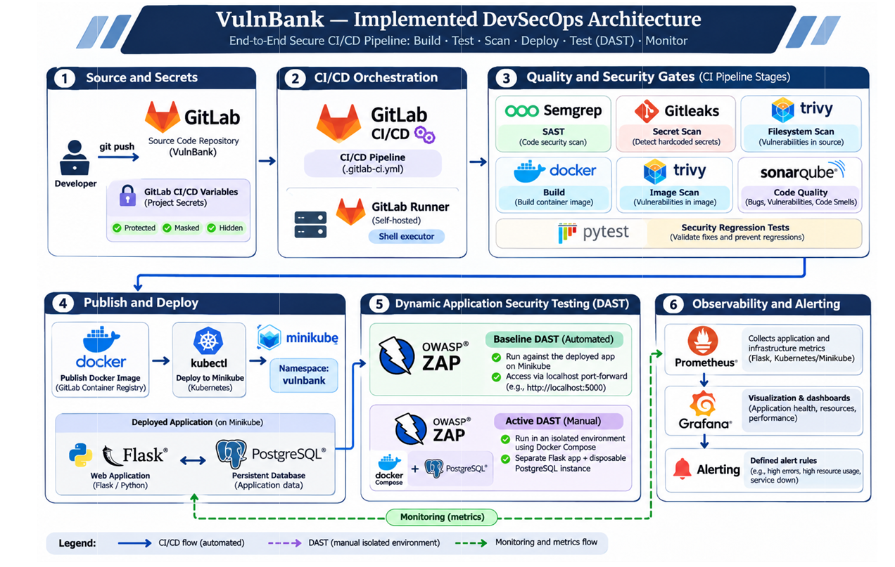
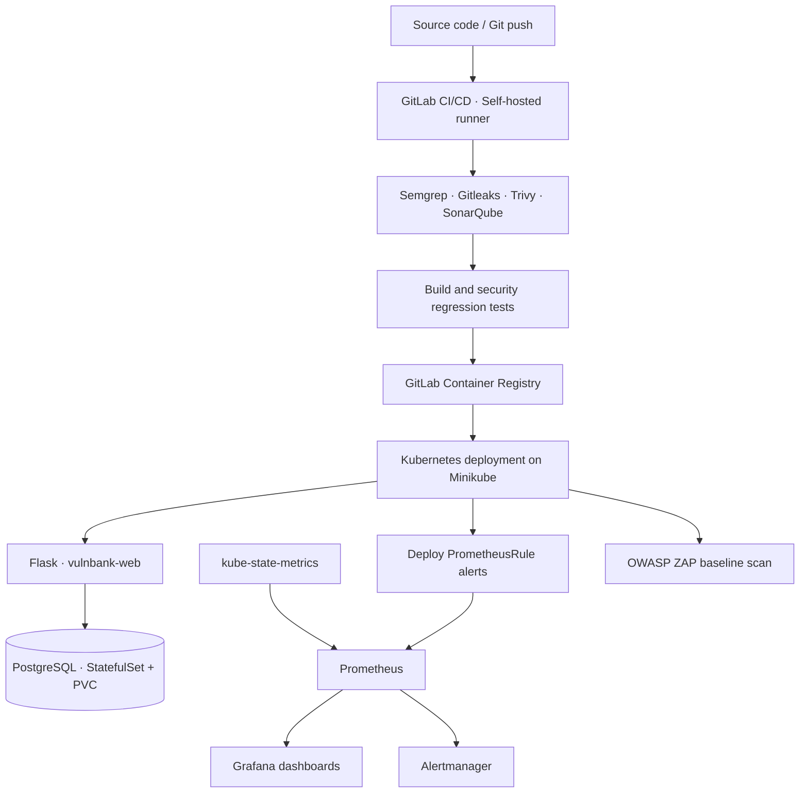

# VulnBank — End-to-End DevSecOps Pipeline

> **An intentionally vulnerable banking application used to demonstrate DevSecOps automation, container and Kubernetes hardening, security testing, and observability in a local lab.**

**Stack:** Python · Flask · PostgreSQL · Docker · GitLab CI/CD · Kubernetes (Minikube) · Helm · Prometheus · Grafana · Alertmanager

> [!WARNING]
> **For education and authorized local testing only.** VulnBank is intentionally vulnerable and must **not** be exposed to the public Internet, used with real customer information, or deployed in production. This project demonstrates selected security controls; it does not claim the application is fully secure.

## Overview

VulnBank is a DevSecOps laboratory project built around a Flask banking application backed by PostgreSQL. The goal is to demonstrate a workflow from source code through automated security checks and a Docker image build to a monitored Kubernetes deployment.

The project combines:

- A GitLab CI/CD pipeline running on a self-hosted runner
- Static analysis, secret scanning, dependency/image vulnerability scanning, code-quality analysis, and security tests
- Container image publishing to the GitLab Container Registry
- Kubernetes deployments with hardened container security contexts
- NetworkPolicies and least-privilege Kubernetes RBAC for CI/CD
- Prometheus, Grafana, and Alertmanager installed via Helm, with custom availability alerts

## Architecture

The following diagram presents the implemented DevSecOps workflow, from GitLab source control and security checks through deployment, DAST, and observability.



> **Architecture note:** The observability deployment currently validates application and database availability primarily through Kubernetes workload-state metrics from `kube-state-metrics`. The diagram is an overview of the system, not a claim that custom Flask instrumentation or incident-response simulation has been completed. The pipeline's baseline DAST is automated; active DAST is manual.

### Architecture flow

1. Developers push code to the GitLab repository, triggering the self-hosted CI/CD runner.
2. Semgrep, Gitleaks, Trivy, SonarQube, and security regression tests assess the code and container image according to the pipeline configuration.
3. Docker images are published to the GitLab Container Registry and deployed to a local Minikube cluster.
4. Flask and PostgreSQL operate in the `vulnbank` namespace with hardened security contexts, NetworkPolicies, and restricted deployment RBAC.
5. OWASP ZAP runs an automated baseline check, with active scanning available as a separate manual job.
6. Prometheus, Grafana, and Alertmanager run in the `monitoring` namespace; the pipeline manages VulnBank availability rules.

### Logical component flow



The Flask application and database run in the `vulnbank` namespace. The observability stack runs in the separate `monitoring` namespace. Kubernetes NetworkPolicies limit application traffic, while GitLab uses the `vulnbank/gitlab-deployer` ServiceAccount for authorized deployment operations.

## Technology stack

| Layer | Tools |
|---|---|
| Application | Python, Flask, PostgreSQL |
| Containers | Docker, Docker Compose |
| CI/CD and registry | GitLab CI/CD, self-hosted GitLab Runner, GitLab Container Registry |
| Security scanning | Semgrep, Gitleaks, Trivy, SonarQube |
| Security validation | Automated security regression tests, OWASP ZAP |
| Orchestration | Kubernetes, Minikube |
| Kubernetes security | Security contexts, NetworkPolicies, RBAC |
| Observability | Helm, kube-prometheus-stack, Prometheus, Grafana, Alertmanager, kube-state-metrics |
| Resource metrics | Minikube Metrics Server addon |

## CI/CD pipeline

The `.gitlab-ci.yml` pipeline is organized into these stages:

| Stage | Purpose |
|---|---|
| `sast` | Semgrep static application security analysis |
| `secrets` | Gitleaks secret detection |
| `filesystem` | Trivy filesystem vulnerability scan |
| `build` | Build the application Docker image |
| `image-security` | Trivy Docker image vulnerability scan |
| `quality` | SonarQube code analysis |
| `security-tests` | Run security regression tests |
| `publish` | Push a commit-specific image to the GitLab Container Registry |
| `deploy` | Deploy PostgreSQL and Flask to Minikube; apply NetworkPolicies |
| `monitoring` | Apply custom Prometheus alert rules and verify monitoring workloads |
| `dast` | Run the OWASP ZAP baseline scan; active scanning is manual |

**Security gate transparency:** In the current pipeline configuration, several scanning jobs generate reports without failing the pipeline on findings (for example, jobs using `|| true` or non-blocking scan exit codes). Docker build, security regression tests, application deployment, and the configured baseline DAST job are blocking. A green pipeline therefore **does not mean all vulnerabilities have been eliminated**.

### Image deployment strategy

The pipeline publishes images tagged with the Git commit SHA:

```text
$CI_REGISTRY_IMAGE:$CI_COMMIT_SHA
```

The Kubernetes deployment uses this commit-specific image rather than an untracked `latest` tag, improving traceability between source code and the running application.

## Kubernetes deployment and hardening

Application resources are defined under [`k8s/`](k8s/).

### Application and database

- **Flask:** Kubernetes Deployment (`vulnbank-web`)
- **PostgreSQL 13:** StatefulSet (`postgres`) with a persistent volume claim
- **Namespace:** `vulnbank`

### Security controls

Both application and database workloads use security contexts designed to reduce container privileges. Controls include:

- Running as non-root users (Flask UID `1000`; PostgreSQL UID `999`)
- `allowPrivilegeEscalation: false`
- `privileged: false`
- Dropping all Linux capabilities
- `seccompProfile: RuntimeDefault`

NetworkPolicies implement a default-deny approach with explicit allowances for required traffic, including communication between the Flask application and PostgreSQL.

### GitLab Runner RBAC

The self-hosted runner authenticates to Kubernetes as:

```text
system:serviceaccount:vulnbank:gitlab-deployer
```

The RBAC configuration in [`k8s/gitlab-rbac.yaml`](k8s/gitlab-rbac.yaml) grants the ServiceAccount permissions to manage application resources in `vulnbank` and custom alert rules in `monitoring`.

The runner is **not** granted permission to create cluster-wide ClusterRoles. Full Helm stack installation and upgrades are administrator-managed instead of being performed by the limited CI identity.

## Monitoring and alerting

Monitoring runs in the `monitoring` namespace and is installed using the `prometheus-community/kube-prometheus-stack` Helm chart.

| Component | Responsibility |
|---|---|
| Prometheus | Collect and evaluate Kubernetes monitoring metrics |
| kube-state-metrics | Expose Kubernetes workload-state metrics |
| Grafana | Visualize application and infrastructure status |
| Alertmanager | Process alerts from Prometheus |
| PrometheusRule | Define VulnBank availability alerts as Kubernetes resources |

Configuration files:

```text
monitoring/
├── values.yaml   # Helm values for the monitoring stack
└── alerts.yaml   # Custom VulnBank availability alerts
```

### Availability alerts

The custom rule file defines:

- **`VulnBankWebUnavailable`** — triggers when the web Deployment has fewer than one available replica for the configured duration.
- **`VulnBankPostgresUnavailable`** — triggers when the PostgreSQL StatefulSet has fewer than one ready replica for the configured duration.

The rules use `kube-state-metrics` and a one-minute alert evaluation duration (`for: 1m`). Alertmanager is configured for internal handling, **without an external email or chat notification receiver**.

Useful PromQL queries:

```promql
kube_deployment_status_replicas_available{namespace="vulnbank",deployment="vulnbank-web"}
```

```promql
kube_statefulset_status_replicas_ready{namespace="vulnbank",statefulset="postgres"}
```

### Open the monitoring interfaces locally

Run each port-forward in a separate terminal:

```bash
# Grafana: http://localhost:3000
kubectl port-forward -n monitoring svc/monitoring-grafana 3000:80

# Prometheus: http://localhost:9090
kubectl port-forward -n monitoring svc/monitoring-kube-prometheus-prometheus 9090:9090

# Alertmanager: http://localhost:9093
kubectl port-forward -n monitoring svc/monitoring-kube-prometheus-alertmanager 9093:9093
```

Retrieve the Grafana admin password **locally** from the Kubernetes Secret; never commit it to the repository:

```bash
kubectl get secret monitoring-grafana -n monitoring \
  -o jsonpath='{.data.admin-password}' | base64 --decode
printf '\n'
```

### Apply monitoring alert rules

After an administrator has installed the monitoring Helm chart and configured the RBAC:

```bash
kubectl apply -f monitoring/alerts.yaml
kubectl get prometheusrule vulnbank-availability-alerts -n monitoring
```

The GitLab monitoring stage automates this alert-rule deployment and verifies workload readiness.

## Running in the local lab

**Prerequisites:** Ubuntu/Linux environment, Docker, a working Minikube cluster, `kubectl`, and Helm. The complete CI/CD workflow additionally requires a configured self-hosted GitLab Runner, registry credentials, and appropriate Kubernetes RBAC.

Once the cluster is configured, inspect the deployed application and monitoring resources:

```bash
kubectl get pods,deployments,statefulsets,services -n vulnbank
kubectl get pods -n monitoring
kubectl get prometheusrules -n monitoring
```

Application manifests are in `k8s/`; monitoring Helm overrides and alerts are in `monitoring/`. Consult the project scripts and `.gitlab-ci.yml` for the lab's specific build, test, and deployment commands. Credentials, Secret values, and private runner configuration must be supplied through secure local or CI settings rather than committed to Git.

## Evidence and screenshots

Add screenshots to `docs/screenshots/` and link them here after checking that they contain no tokens, passwords, sensitive URLs, or other secrets.

Recommended evidence:

- GitLab pipeline with completed stages
- GitLab security-scan artifacts / summarized findings
- Kubernetes application and monitoring workload status
- Grafana availability dashboard
- Prometheus custom alert rules
- Kubernetes RBAC permission checks and NetworkPolicy validation

## Scope and limitations

- VulnBank is **intentionally vulnerable** and remains suitable only for isolated, authorized lab use.
- Security scans configured in reporting mode do not enforce zero-vulnerability deployment gates.
- Monitoring is configured for a local Minikube environment; monitoring data and Grafana state are not configured for durable production retention.
- Alertmanager has no external notification integration in the current setup.
- The monitoring alerts track workload availability, not end-to-end business transaction success.
- A controlled attack simulation and formal incident-response exercise were **not implemented** in the final project scope.
- A successful pipeline demonstrates that configured jobs completed; it does not constitute a production security assessment.

## Repository layout

```text
vuln-bank/
├── .gitlab-ci.yml
├── Dockerfile
├── docker-compose.yml
├── k8s/
│   ├── web.yaml
│   ├── postgres.yaml
│   ├── gitlab-rbac.yaml
│   └── network-policies/
├── monitoring/
│   ├── values.yaml
│   └── alerts.yaml
├── vulnbank-devsecops-architecture.png
├── scripts/
├── tests/
└── README.md
```

*The tree highlights the main DevSecOps files rather than every application source file.*

## Project purpose

This project demonstrates practical experience integrating application development, CI/CD automation, container security, Kubernetes access control, automated security testing, and infrastructure observability. Its main value is the combination of these disciplines in a reproducible local learning environment, together with explicit documentation of what was tested and what remains out of scope.
